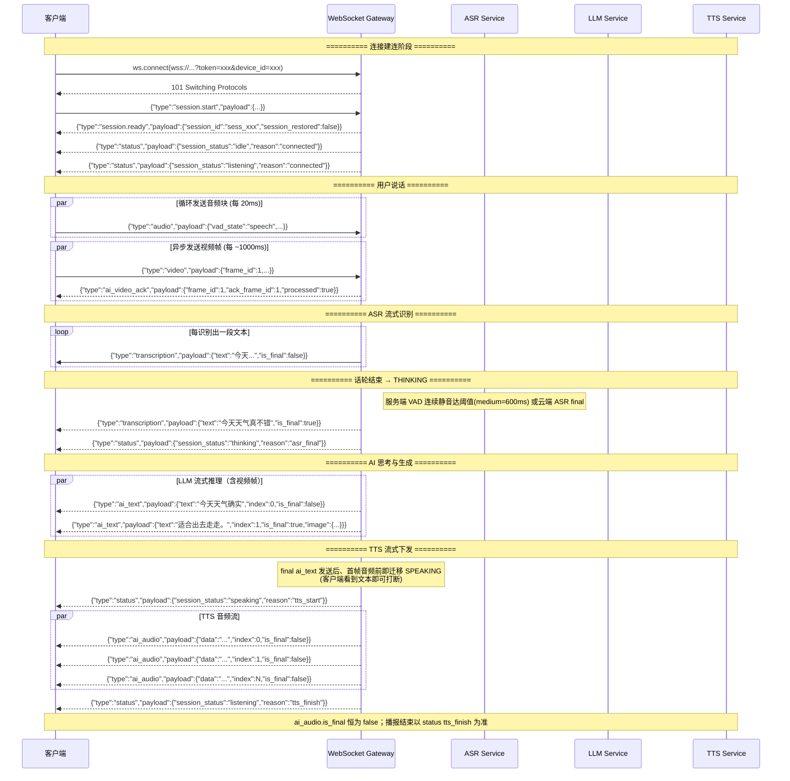
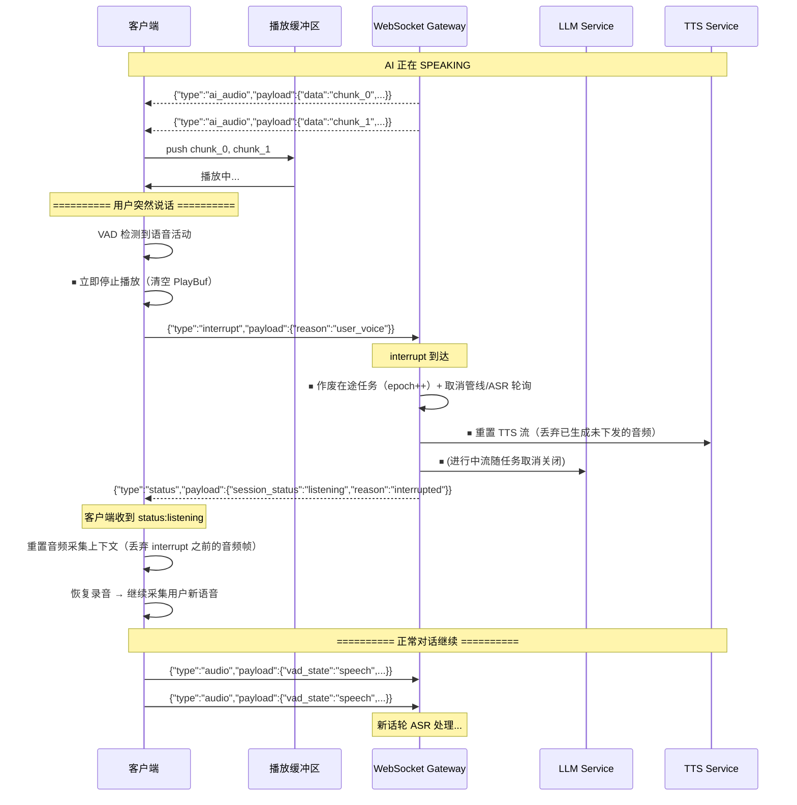
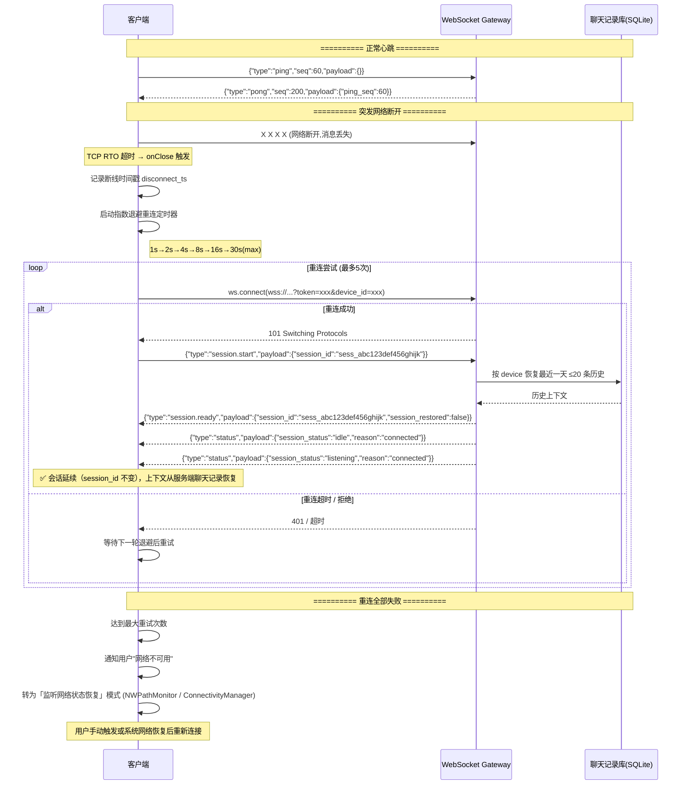

# LivaChat WebSocket 通信协议设计文档

**版本**: v1.3
**状态**: 生效  
**生效日期**: 2026-11-06
**适用范围**: iOS / Android 客户端 ↔ Python FastAPI 网关  
**版本管理**: 本文档与 `packages/api-schema/` 目录下的 JSON Schema 文件同步更新

> **v1.3 变更摘要（2026-11-06）**：新增 AVDetector 会话级开关。`session.start.config` 增加可选 `avdetector: "enable"|"disable"`（缺省 enable；显式 null 非法）；`session.change` 增加控制伪模式 `mode="config"`（携带 `avdetector`）；`session.changed` 增加 `mode="config"` 回声与 `avdetector` 字段；新增错误码 `1011 SESSION_CONFIG_FAILED`（与模式切换拒绝 `1009` 严格分离）。详见 `docs/avdetector_improvements.md`。
>
> **v1.2 变更摘要（2026-10-17）**：`session.start.config.client_version` 增加可选第 4 段构建号（Android 为 `versionCode`，如 `android-1.0.0.130`；老客户端可继续只发 3 段）；`session.ready` 新增可选 `server_version`（服务端恒发送，客户端仅携带，不做版本比较）。详见 `docs/version_management.md`。
>
> **v1.1 变更摘要（对齐 2026-10 服务端实现）**：新增 `session.change` / `session.changed`（会话内模式切换：chat / translate / transcribe / omni）与 `job_status`（后台任务快照）；`video` 的 `orientation` 改为角度整数并新增 `camera_facing`、`text` 字段；`ai_text` 新增 `source` / `reply_to` / `agent_name` / `proactive` / `image` 字段；`status.reason` 新增 `mode_changed`；心跳改为服务端 15s 无入帧发 ping、45s 无任何入帧关闭 4002（原 60s 空闲踢线已移除）；错误码表按实现重写；明确 `session.ended` 仅在服务端主动结束（连接被顶替/关服）时下发，客户端 `session.end` 无回执；下线 Redis 会话快照相关描述（会话恢复改由聊天记录库承担）。

---

## 1. 协议概述与连接建立

### 1.1 WebSocket URL 规范

```text
wss://{host}/v1/ws/stream?token={token}&device_id={uuid}
```

| 参数 | 类型 | 必填 | 说明 |
|------|------|------|------|
| `token` | string | 是 | 认证凭据（wire token）。当前 `auth.mode=dev`：必须是 `sha1_hex(auth.dev_token + "LivaChat")` 固定盐摘要——明文 secret 不上网（docs/server_auth.md）；`jwt` 模式为预留（HS256 配置项已备，签发流程未实现） |
| `device_id` | string(uuid v4) | 是 | 客户端设备唯一标识，首次启动生成后持久化存储于 Keychain / EncryptedSharedPreferences |

**鉴权失败响应**：服务端在 WebSocket 握手阶段（`accept` 之前）以 HTTP 401 直接拒绝，连接不会建立，因此不会有 WebSocket close code。`device_id` 非合法 UUID 同样返回 401。

> **关于 JWT（预留设计）**：未来 `auth.mode=jwt` 时使用 HS256（生产建议 RS256）签发的 JWT，载荷含 `sub` / `device_id` / `iat` / `exp`。当前联调环境均使用 dev wire token（固定盐摘要，docs/server_auth.md）。

### 1.2 传输层约定

| 项 | 规格 |
|-----|--------|
| 协议 | WSS (TLS)，dev 环境由 `server.ssl` 配置开关 |
| 帧类型 | Text Frame（UTF-8 JSON） |
| 二进制帧 | MVP 阶段不启用，预留 upgrade 信令 |
| 消息大小上限 | 单帧 ≤ 2MB（`server.max_frame_bytes`，含 JSON 包装与 base64 后的视频帧） |
| 帧间隔 | 音频 20ms 一帧（`duration_ms: 20`）；视频约 1000ms 一帧 |
| 压缩 | 未启用（`permessage-deflate` 为预留项，服务端当前不协商） |

> **关于 Base64 膨胀**：Base64 带来的 ~33% 体积膨胀在 MVP 阶段可接受。若后续带宽成为瓶颈，按 4.2 节降级策略处理；长期方案为升级至 Binary Frame + Protobuf / FlatBuffers。

### 1.3 连接生命周期

```
┌──────────────┐     ┌──────────────┐     ┌──────────────┐     ┌──────────────┐
│    CLOSED    │────►│  CONNECTING  │────►│    OPEN      │────►│   CLOSING    │
│  (初始状态)   │     │  (握手阶段)   │     │  (数据传输)   │     │  (优雅关闭)   │
└──────────────┘     └──────────────┘     └──────────────┘     └──────┬───────┘
       ▲                                                               │
       │                                                               ▼
       └─────────────────────────────────────────────────────────── CLOSED
```

| 阶段 | 触发方 | 行为 |
|------|--------|------|
| **CONNECTING** | Client | 发起 WebSocket 握手，携带鉴权参数 |
| **OPEN** | Server | 握手成功后，认证成功，链接建立 |
| **数据传输** | Both | 双向发送音频、视频、控制信令 |
| **CLOSING** | Client/Server | 主动关闭 (Code 1000)、解码保护 (4001) 或心跳超时 (4002) |
| **CLOSED** | - | 连接完全断开，客户端按重连策略重试 |

**超时策略**：

| 超时类型 | 阈值 | 动作 |
|----------|-------|--------|
| 连接超时 | 10s（从 ws.connect 到 onOpen，客户端侧建议） | 客户端重试 |
| 心跳间隔 | 15s（服务端连续 15s 未收到任何入帧时主动发 `ping`） | 客户端应尽快回 `pong` |
| 心跳超时 | 45s（服务端连续 45s 未收到**任何**入帧，含 ping/pong） | 服务端主动关闭，code: 4002 |
| 解码保护 | 连续 10 帧 JSON 解析/校验失败 | 服务端关闭，code: 4001（前 9 帧各回一条 error:1006，第 10 帧直接关闭） |

> **注意**：旧版协议的"60s 空闲踢线（4003）"已移除（2026-08-28）——服务端只以"是否有任意帧"判定存活，后台 App 仅送心跳即可保活。`4003` 现为枚举保留（真实模式切换的 `session.change` 拒绝用 `1009`；`mode="config"` 的失败用 `1011`，见 4.3）。
>
> **会话上下文**：断线重连不再依赖服务端会话快照 TTL。同一 `device_id` 建立新连接会顶掉旧连接（已建立会话的旧连接收到 `session.ended(reason=server_shutdown)` 后被服务端停止）；重连后由客户端在 `session.start` 中携带旧 `session_id`，服务端延续该 session_id 并从聊天记录库（SQLite）恢复最近上下文（最近一天、≤20 条）。详见 3.3 节。

---

## 2. 消息结构规范

### 2.1 公共 Wrapper 定义

所有消息（C2S 与 S2C 共用）使用同一外层结构：

```json
{
  "type": "<string>",
  "seq": <integer>,
  "timestamp": <integer>,
  "payload": { }
}
```

| 字段 | 类型 | 必填 | 说明 |
|------|------|------|------|
| `type` | `string` | 是 | 消息类型枚举，参见下方类型表 |
| `seq` | `uint32` | 是 | **每个方向独立维护**的单调递增序列号（客户端 C2S seq；服务端 S2C seq）。从 1 开始，连接断开后重置。详见第 4.1 节。服务端同一连接内收到新的 `session.start` 会重置入站 seq 水位（允许客户端在同一连接内重新从 1 计数）；`ping`/`pong` 不参与 seq 校验。 |
| `timestamp` | `uint64` | 是 | 发送方的**本地 UTC 毫秒时间戳**（`time.time() * 1000`），用于单向延迟计算、帧同步 |
| `payload` | `object` | 是 | 消息体，根据 type 不同有不同结构 |

**消息类型枚举（type 字段）**：

| 方向 | type | 说明 |
|------|------|------|
| C2S | `session.start` | 开始新会话（或携带旧 session_id 重连延续） |
| C2S | `session.end` | 主动结束会话 |
| C2S | `session.change` | 会话内模式切换（chat / translate / transcribe / omni） |
| C2S | `audio` | Opus 编码的音频数据块 |
| C2S | `video` | JPEG 编码的视频帧（可携带文本指令） |
| C2S | `interrupt` | 打断当前 AI 输出 |
| C2S | `ping` | 客户端心跳 |
| C2S | `pong` | 客户端对服务端 ping 的回复 |
| S2C | `session.ready` | 会话就绪通知 |
| S2C | `session.ended` | 会话结束通知 |
| S2C | `session.changed` | 模式切换确认 |
| S2C | `transcription` | ASR 识别结果（中间/最终） |
| S2C | `ai_text` | AI 流式文本输出 |
| S2C | `ai_audio` | TTS 音频数据块 |
| S2C | `ai_video_ack` | 视频帧处理确认 |
| S2C | `status` | 会话状态变更通知 |
| S2C | `job_status` | 后台任务运行状态快照 |
| S2C | `error` | 错误通知 |
| S2C | `ping` | 服务端心跳 |
| S2C | `pong` | 服务端对客户端 ping 的回复 |

---

### 2.2 客户端 → 服务端消息定义

#### 2.2.1 `session.start` — 开始新会话

```json
{
  "type": "session.start",
  "seq": 1,
  "timestamp": 1712345678000,
  "payload": {
    "session_id": null,
    "config": {
      "enable_video": true,
      "audio_sample_rate": 24000,
      "vad_sensitivity": "medium",
      "client_version": "android-1.0.0.130",
      "timezone": "Asia/Shanghai",
      "language": "zh-Hans",
      "avdetector": "enable"
    }
  }
}
```

| 字段 | 类型 | 必填 | 说明 |
|------|------|------|------|
| `payload.session_id` | `string\|null` | 是 | 重连时填之前 session_id（延续会话并从聊天记录恢复上下文），首次填 null |
| `payload.config.enable_video` | `bool` | 是 | 是否启用摄像头采集（false 时服务端不会把视频帧附带进对话） |
| `payload.config.audio_sample_rate` | `uint16` | 是 | 枚举值：`16000` / `24000` |
| `payload.config.vad_sensitivity` | `string` | 是 | 枚举值：`"low"` / `"medium"` / `"high"`，映射回合结束静音阈值：low=45 帧(~900ms)、medium=30 帧(~600ms)、high=20 帧(~400ms) |
| `payload.config.client_version` | `string` | 是 | 客户端版本号，格式 `(ios\|android)-x.y.z[.build]`；Android 第 4 段为 `versionCode`（如 `android-1.0.0.130`），老客户端可只发 3 段 |
| `payload.config.timezone` | `string` | 否 | 客户端本地时区 ID（如 `"Asia/Shanghai"`；部分 Android 设备为 `"GMT+08:00"`）。原样上报系统值，服务端负责归一化，非法值忽略 |
| `payload.config.language` | `string` | 否 | App 当前 UI 语言 canonical code（如 `"en"`、`"zh-Hans"`、`"zh-Hant"`、`"pt"`、`"ar"`），不是设备语言；老客户端可省略。服务端保存到会话变量，用于主动对话历史文本、chat 普通回合输出语言回落（`docs/server_multilingual.md` §4.12）与 agent relay 用户可见输出语言（`docs/agent_multilingual.md`）；空/未知按 `en` 处理 |
| `payload.config.avdetector` | `string` | 否 | AVDetector 会话级开关：`"enable"` / `"disable"`。**字段缺省/未携带 = enable**（老客户端行为不变）；**显式 null 非法**（DTO 若接受 null，服务端按 1006 malformed 拒绝）。`default` 仅为 Schema 注解，服务端自己实现缺省逻辑 |

> **兼容性**：`config` 允许携带未定义字段（`additionalProperties: true`），服务端保留但不消费，用于前后兼容。
>
> **同一连接可重复发送**：服务端允许在同一连接内再次发送 `session.start`（视为重开会话）——编排器会复位会话状态与模式的默认值（回到 chat/full），网关重置 seq 水位。

服务端响应顺序：`session.ready` → `status(idle, connected)` → `status(listening, connected)`。

#### 2.2.2 `session.end` — 结束会话

```json
{
  "type": "session.end",
  "seq": 145,
  "timestamp": 1712345778000,
  "payload": {
    "reason": "user_quit"
  }
}
```

| 字段 | 类型 | 必填 | 说明 |
|------|------|------|------|
| `payload.reason` | `string` | 是 | 枚举值：`"user_quit"` / `"app_background"` / `"app_terminate"`（客户端常用）；完整枚举另含 `"server_shutdown"` / `"error"` / `"idle_timeout"` |

服务端收到后：取消在途管线与 ASR 轮询、并发关闭 ASR/TTS/子引擎、向 Agent Relay 发布会话结束、清理会话上下文，并停止该连接的处理（此后不再处理任何业务消息）。**服务端不在该路径回发 `session.ended`**——`session.ended` 仅由服务端在主动结束会话时下发（见 2.3.2）；客户端发送 `session.end` 后应自行关闭 WebSocket，服务端以连接断开完成资源收尾。若当前连接从未建立会话，服务端同样停止连接处理。

#### 2.2.3 `session.change` — 切换会话模式

```json
{
  "type": "session.change",
  "seq": 42,
  "timestamp": 1712345680000,
  "payload": {
    "mode": "translate",
    "my_language": "zh",
    "local_language": "ja"
  }
}
```

| 字段 | 类型 | 必填 | 说明 |
|------|------|------|------|
| `payload.mode` | `string` | 是 | 目标模式：`"chat"`（默认对话）/ `"translate"`（翻译）/ `"transcribe"`（纯转录，无 LLM/TTS）/ `"omni"`（全模态实时模型）/ `"config"`（**控制伪模式**：只应用本 payload 的配置字段，不切换 pipeline mode） |
| `payload.my_language` | `string` | 条件 | 用户母语码（如 `"zh"`）。mode=translate 时必需（缺省服务端按 `"zh"` 兜底并告警） |
| `payload.local_language` | `string` | 条件 | 环境语言码（如 `"ja"`）。mode=translate 时必需（缺省按 `"en"` 兜底）；保留字 `"auto"`（仅 dialogue 翻译支持，自动识别对方语言；lecture 下服务端归一为 `"en"`） |
| `payload.usecase` | `string` | 否 | 仅 mode=translate 有意义：`"dialogue"`（默认，逐轮 LLM 翻译）/ `"lecture"`（流式同传，LiveTranslate） |
| `payload.avdetector` | `string` | 条件 | 仅 `mode="config"` 必填：`"enable"` / `"disable"`，修改当前会话的 AVDetector 开关。其它 mode 忽略。显式 null 非法 |

服务端行为：

1. 校验模式归属后**立即执行切换**（关闭旧子引擎、取消在途 LLM/TTS 等），回 `session.changed` 确认，再以当前状态回 `status(reason="mode_changed")`。
2. `transcribe`：取消在途 LLM/TTS，ASR 流保持，`transcription` 照常下发，但不产生 `ai_text` / `ai_audio`。
3. `omni`：关闭 ASR/TTS，转入全模态引擎（单流音频+图像进、文本+音频出）；服务端未启用 omni 或开流失败时回 `error(1009, "omni mode unavailable")` 且**不发** `session.changed`（客户端应回滚本次切换的乐观置位）。
4. `lecture`：进入 LiveTranslate 流式同传；开流失败时回 `error(1008, ...)` 并自动降级为逐轮 LLM 翻译（仍发 `session.changed(mode="translate")`）。
5. 错误：会话未建立回 `error(1009, "session not started")`；非法 mode 回 `error(1009, "invalid mode: ...")`（非法 mode 在协议层即被 1006 拦截，此分支为防御性）。**但 `mode="config"` 的所有业务失败使用 1011 `SESSION_CONFIG_FAILED`，不使用 1009**——避免客户端把 config 失败误判为真实模式切换被拒并回滚 `pendingModeChange`。
6. `config`：仅修改 `session.avdetector_enabled`，不改变 pipeline mode、不关闭/重建其他引擎、不发送 `status(mode_changed)`。成功回 `session.changed(mode="config", avdetector=...)`；`avdetector` 缺失/非法、会话未建立或应用失败回 `error(1011, ...)`。

#### 2.2.4 `audio` — 音频数据块

```json
{
  "type": "audio",
  "seq": 34,
  "timestamp": 1712345681020,
  "payload": {
    "data": "//uQxAAAAA...<Base64 Opus>...",
    "codec": "opus",
    "duration_ms": 20,
    "vad_state": "speech"
  }
}
```

| 字段 | 类型 | 必填 | 说明 |
|------|------|------|------|
| `payload.data` | `string` | 是 | Base64 编码的 Opus 数据包。编码参数：20ms 帧长，16/24kHz 采样率，CBR 模式，码率 32–64 kbps |
| `payload.codec` | `string` | 是 | 固定值 `"opus"` |
| `payload.duration_ms` | `uint16` | 是 | 该帧的时长（毫秒）。枚举值：`20` / `40`（当前实现按 20ms 处理） |
| `payload.vad_state` | `string` | 是 | 客户端 VAD 结果：`"silence"` / `"speech"` |

**服务端处理规则**：

- 时序约束：客户端应保证每 20ms 发送一个 `audio` 帧，不允许突增/突减间隔。服务端按帧计数换算静音时长（当前实现按 20ms/帧）。
- 回合结束判定：连续静音帧达到 `vad_sensitivity` 对应阈值（默认 medium = 30 帧 / 600ms）即判定用户话轮结束（进入 THINKING）。云端 ASR 侧也可能先行给出 final（服务端同样触发回合结束，二者去重）。
- 状态门控：仅 `LISTENING` / `SPEAKING` 状态下处理音频帧；`THINKING` 期间的帧被丢弃。
- SPEAKING 期间为**服务端 barge-in**：从出现 `vad_state:"speech"` 的帧开始重新进 ASR；仅当 ASR 产出有效文本（去除尾部标点后 ≥2 字符）才确认为真实打断（噪声/回声不打断）。
- 少于 2 个有效字符的 final（如"嗯。"）会照常下发 `transcription` 供客户端展示，但不触发 LLM。
- 畸形帧（base64 非法/Opus 解码失败）静默丢弃。

#### 2.2.5 `video` — 视频帧

```json
{
  "type": "video",
  "seq": 12,
  "timestamp": 1712345682000,
  "payload": {
    "data": "/9j/4AAQ...<Base64 JPEG>...",
    "frame_id": 7,
    "width": 1080,
    "height": 1920,
    "orientation": 270,
    "camera_facing": "front",
    "quality": 70,
    "turn_id": 3
  }
}
```

| 字段 | 类型 | 必填 | 说明 |
|------|------|------|------|
| `payload.data` | `string` | 是 | Base64 编码的 JPEG 帧 |
| `payload.frame_id` | `uint32` | 是 | 视频帧序列号，单调递增，用于与 `ai_video_ack` 帧确认配对 |
| `payload.width` | `uint16` | 是 | 原始图像宽度（像素），如 `1080` |
| `payload.height` | `uint16` | 是 | 原始图像高度（像素），如 `1920` |
| `payload.orientation` | `int` | 是 | 画面摆正所需旋转角度，枚举：`0` / `90` / `180` / `270` |
| `payload.camera_facing` | `string` | 是 | 枚举值：`"front"` / `"back"` / `"screen"`（屏幕采集） / `"gallery"`（图库照片；后两者均非实时摄像头） |
| `payload.quality` | `uint8` | 是 | JPEG 压缩质量 1–100，建议 60–80。取值由客户端动态自适应调整（见 4.2 节） |
| `payload.turn_id` | `uint32` | 否 | 采集轮标识（有效值从 `1` 起）。客户端每次打开摄像头 / 切换前后摄像头 / 开始录屏时递增；服务端检测到变化时把该帧视为新轮首帧，**不等待 ASR 立即发起一轮 LLM/TTS 对话**（详见 docs/fd_pipeline_video_process.md §8）。缺省或 `0` = 未启用（等同旧客户端，行为与现状完全一致） |
| `payload.text` | `string` | 否 | 随帧文本指令（≤512 字符）。非空时服务端**立即以该文本发起一轮对话**（无需 ASR 回合），本帧作为该轮的图片；仅在 chat 模式（translate / transcribe / omni 下忽略）且文本有效字符 ≥2 时生效。为空/缺省时仅作普通视频帧缓冲；带 text 的帧不触发 turn_id 首帧直起轮 |

**服务端处理规则**：

- 视频帧与音频帧**异步发送**，不与音频帧对齐。会话建立后，任何状态下帧都会进入缓冲区。
- 服务端视频缓冲区**仅保留最新 1 帧**（K=1，新帧顶替旧帧）；连续 5s 无新帧时缓冲区自动清空。
- 帧在用户回合结束时被消费（快照）：作为该轮请求的图片送多模态 LLM，并回带在 final `ai_text.image` 中；`enable_video=false` 或 translate/transcribe 模式不消费。
- **turn 首帧直起轮**：`payload.turn_id` 变化 = 新采集轮首帧，服务端立即起一轮（LLM/TTS，不等 ASR），历史 user 行以 `[相机画面]` 标记 + 本帧图片落库/回图；无 `turn_id` / `turn_id=0` 的帧与带 `text` 的帧行为不变（见 docs/fd_pipeline_video_process.md §8）。
- 每帧都会收到 `ai_video_ack` 确认（见 2.3.7）。
- **seq 例外**：客户端 video 的取号与编码在发送闸口外完成，推流期 seq 回退属常态；服务端对 `video` 的 seq 回退仅记日志，照常处理（见 4.1.1）。

#### 2.2.6 `interrupt` — 打断

```json
{
  "type": "interrupt",
  "seq": 58,
  "timestamp": 1712345683000,
  "payload": {
    "reason": "user_voice"
  }
}
```

| 字段 | 类型 | 必填 | 说明 |
|------|------|------|------|
| `payload.reason` | `string` | 是 | 枚举值：`"user_voice"`（VAD 检测到用户开始说话）/ `"manual"`（用户手动点击打断按钮） |

服务端收到后执行完整打断序列：作废在途 LLM/TTS 任务（epoch 递增）→ 取消管线与 ASR 轮询 → 重置 ASR/TTS 流与回合状态 → 回 `status(listening, interrupted)`。该信令在 chat / translate / lecture / omni 各模式均有效（lecture / omni 下转发给对应引擎取消在途响应）。打断无专用 ack，`status(listening, interrupted)` 即为处理完成的标志。

> **关键约束**：`interrupt` 消息应**优先于后续音频帧发送**，客户端可考虑在发送 interrupt 时临时禁用 Nagle 风格的缓冲，确保 interrupt 尽早到达服务端。详见第 3.2 节时序图。

#### 2.2.7 `ping` / `pong` — 心跳

**客户端 ping：**

```json
{
  "type": "ping",
  "seq": 60,
  "timestamp": 1712345685000,
  "payload": {}
}
```

**客户端 pong（回复服务端 ping）：**

```json
{
  "type": "pong",
  "seq": 61,
  "timestamp": 1712345685100,
  "payload": {
    "ping_seq": 2001
  }
}
```

| 字段 | 类型 | 必填 | 说明 |
|------|------|------|------|
| `payload.ping_seq` | uint32 | 是  | 回显对端 ping 的序列号 |

**心跳策略（服务端实现）**：

- 服务端连续 **15s** 未收到任何入帧时，主动下发 `ping`（空 payload）。
- 服务端连续 **45s** 未收到任何入帧（含 ping/pong）时，关闭连接（code: 4002）。
- 客户端收到服务端 `ping` 后应尽快回 `pong`；客户端也可自行周期 ping（服务端回 `pong` 并回显 `ping_seq`）。
- 任一方发送任何消息（含 audio/video/pong）都会刷新服务端计时。

---

### 2.3 服务端 → 客户端消息定义

#### 2.3.1 `session.ready` — 会话就绪

```json
{
  "type": "session.ready",
  "seq": 1,
  "timestamp": 1712345678200,
  "payload": {
    "session_id": "sess_abc123def456ghijk",
    "session_restored": false,
    "server_time_ms": 1712345678200,
    "keepalive_interval_s": 15,
    "server_version": "0.1.0"
  }
}
```

| 字段 | 类型 | 必填 | 说明 |
|------|------|------|------|
| `payload.session_id` | `string` | 是 | 会话标识符，格式 `sess_` + 18 位小写字母数字。客户端携带旧 session_id 重连时原样延续 |
| `payload.session_restored` | `bool` | 是 | **当前实现恒为 `false`**（历史上下文恢复不再以该标志区分——只要客户端携带 resume_id，服务端即从聊天记录恢复上下文）。保留字段供兼容 |
| `payload.server_time_ms` | `uint64` | 是 | 服务端当前 UTC 毫秒时间戳，客户端可用于计算时钟偏差 |
| `payload.keepalive_interval_s` | `uint8` | 是 | 服务端建议的心跳间隔（秒），当前恒为 `15` |
| `payload.server_version` | `string` | 否 | 服务端包版本（PEP 440，如 `"0.1.0"`）。服务端恒发送；客户端仅携带，不得据此改变行为（`docs/version_management.md`） |

#### 2.3.2 `session.ended` — 会话结束

```json
{
  "type": "session.ended",
  "seq": 204,
  "timestamp": 1712345778200,
  "payload": {
    "reason": "user_quit",
    "session_id": "sess_abc123def456ghijk"
  }
}
```

| 字段 | 类型 | 必填 | 说明 |
|------|------|------|------|
| `payload.reason` | `string` | 是 | 枚举值：`"user_quit"` / `"app_background"` / `"app_terminate"` / `"server_shutdown"` / `"error"` / `"idle_timeout"` |
| `payload.session_id` | `string` | 是 | 对应的 session_id（仅已建立会话的旧连接会收到本消息） |

服务端下发时机：

1. **同 device_id 新连接顶掉旧连接**——已建立会话的旧连接收到 `session.ended(reason="server_shutdown")` 后被服务端停止；
2. 服务端进程优雅关闭（SIGTERM）时对所有已建立会话的活跃连接发送。

**客户端主动发送 `session.end` 不会收到本消息**（服务端直接停止会话处理，见 2.2.2）——客户端应以本地流程完成结束 UI 与连接关闭。`"error"` / `"idle_timeout"` 为枚举预留，当前无下发路径。

#### 2.3.3 `session.changed` — 模式切换确认

```json
{
  "type": "session.changed",
  "seq": 43,
  "timestamp": 1712345680100,
  "payload": {
    "mode": "translate",
    "my_language": "zh",
    "local_language": "ja"
  }
}
```

| 字段 | 类型 | 必填 | 说明 |
|------|------|------|------|
| `payload.mode` | `string` | 是 | 切换后生效的模式：`"chat"` / `"translate"` / `"transcribe"` / `"omni"`；`"config"` 是**配置确认回声**，表示 `session.change(mode="config")` 已应用，**不表示 pipeline mode 变化**，客户端不得据此更新模式状态机 |
| `payload.my_language` | `string` | 否 | 回显用户语言；仅 translate 模式携带，其余模式省略 |
| `payload.local_language` | `string` | 否 | 回显环境语言；仅 translate 模式携带，其余模式省略 |
| `payload.usecase` | `string` | 否 | 回显翻译用途：lecture 请求/生效时为 `"lecture"`；其余 translate 回显请求原值（未提供时省略，非法值归一为 `"dialogue"`）；非 translate 省略 |
| `payload.avdetector` | `string` | 否 | 仅 `mode="config"` 回声携带：本次生效的 AVDetector 开关 `"enable"` / `"disable"`；普通模式切换不携带 |

> 普通模式切换：服务端在发出本消息后紧跟一条 `status(reason="mode_changed")`，客户端应以 `status` 为准更新状态指示。omni 开流失败时不发本消息、只回 `error(1009)`（客户端按切换失败处理）。
>
> `mode="config"`：不发送 `status(mode_changed)`；客户端 SDK 必须拦截该回声，不得送入模式状态机（本仓库 Android/iOS SDK 已实现）。

#### 2.3.4 `transcription` — ASR 识别结果

```json
{
  "type": "transcription",
  "seq": 15,
  "timestamp": 1712345683500,
  "payload": {
    "text": "今天天气真不错",
    "is_final": false,
    "transcription_id": "trans_a1b2c3d4e5f6"
  }
}
```

| 字段 | 类型 | 必填 | 说明 |
|------|------|------|------|
| `payload.text` | `string` | 是 | ASR 识别文本。中间结果可能随新音频修正 |
| `payload.is_final` | `bool` | 是 | `false` = 中间结果（interim），`true` = 最终结果（final）。客户端应根据此字段决定是否在对话气泡中最终显示 |
| `payload.transcription_id` | `string` | 是 | 本次话轮的转录批次 ID，`trans_` + 12 位小写字母数字。同一轮的 interim 与 final 共享同一 ID |

**特殊语义**：

- **空文本 final = 清除信号**：云端偶尔先给出有文本的 interim、再以空文本收尾（撤回）。此时服务端会补发一条 `text: ""`、`is_final: true` 的 `transcription`，客户端收到后应清除当前未定稿的 interim 展示（该帧不落聊天记录）。
- 服务端只在 interim 非空时下发 interim。
- `is_final == true` 表示服务端已判定用户话轮结束，随后进入 THINKING（transcribe 模式除外，其停留在 LISTENING）。

#### 2.3.5 `ai_text` — AI 文本回复

```json
{
  "type": "ai_text",
  "seq": 30,
  "timestamp": 1712345684000,
  "payload": {
    "text": "今天天气确实",
    "message_id": "msg_xyz789abcdef",
    "index": 1,
    "is_final": false
  }
}
```

| 字段 | 类型 | 必填 | 说明 |
|------|------|------|------|
| `payload.text` | `string` | 是 | LLM 流式输出的一个文本片段。首块可能为空串 |
| `payload.message_id` | `string` | 是 | 本轮 AI 回复的唯一标识。同属一轮回复的消息块共享同一 `message_id`。格式见下 |
| `payload.index` | `uint32` | 是 | 文本片段的序号，从 0 开始递增 |
| `payload.is_final` | `bool` | 是 | `true` 表示这是本轮回复的最后一段文本 |
| `payload.source` | `string` | 否 | 消息来源：缺省 = `"llm"`（对话/翻译）；`"agent"` = 外部 Agent 推送 |
| `payload.reply_to` | `string` | 否 | `source="agent"` 时为所回应的用户语句 `transcription_id` |
| `payload.agent_name` | `string` | 否 | `source="agent"` 时标识产出方（如 `"hermes"`） |
| `payload.proactive` | `bool` | 否 | 是否为主动推送（非应答用户话语） |
| `payload.image` | `object` | 否 | 本轮展示给 LLM 的相机帧回带（仅 chat 模式下 is_final 且本轮有可用帧时携带）。结构见下 |

**`message_id` 格式约定**：

| 场景 | 格式 | 说明 |
|------|------|------|
| 对话/翻译/lecture/omni 回复 | `msg_` + 12 位小写字母数字 | 常规 LLM 回复 |
| Agent 主动消息（chatlog watcher 等） | `msg_agent_` + 16 位 hex | Agent 主动推送 |
| Agent 后台任务结果 | `msg_agent_job_{job_id}` | **确定性幂等键**：与 `job_status.jobs[].job_id` 对应，客户端可据此将结果气泡对齐到任务状态项并去重（重连补投同键） |

**`payload.image` 结构**（回带帧）：

| 字段 | 类型 | 必填 | 说明 |
|------|------|------|------|
| `image.data` | `string` | 是 | Base64 JPEG |
| `image.mime` | `string` | 是 | 固定 `"image/jpeg"` |
| `image.width` / `image.height` | `int` | 是 | 原始尺寸 |
| `image.orientation` | `int` | 是 | `0` / `90` / `180` / `270` |
| `image.camera_facing` | `string` | 是 | `"front"` / `"back"` / `"screen"` / `"gallery"`（上行值原样回显） |

**失败透出（重要）**：LLM 流式失败时服务端**不发送 `error` 帧**，而是把错误信息附加到本轮 final `ai_text.text`（截断至 1000 字符；若已有片段上屏则以 `\n` 连接）。该错误文本不是正常 AI 回复——服务端不会将其写入历史/聊天记录，且对不可恢复的 4xx（HTTP 408/429 除外）会回滚该轮 user 记录。客户端应直接展示 final 文本，不做特殊分支。

> 客户端可将 `ai_text` 的文本实时展示在对话气泡中。`source="agent"` 的消息可能**在任意时刻**到达（主动推送/后台任务完成），`is_final` 恒为 true、`index` 恒为 0。

#### 2.3.6 `ai_audio` — TTS 音频数据块

```json
{
  "type": "ai_audio",
  "seq": 40,
  "timestamp": 1712345684200,
  "payload": {
    "data": "//uQxAAAAA...<Base64 Opus>...",
    "codec": "opus",
    "message_id": "msg_xyz789abcdef",
    "index": 0,
    "duration_ms": 20,
    "is_final": false
  }
}
```

| 字段 | 类型 | 必填 | 说明 |
|------|------|------|------|
| `payload.data` | `string` | 是 | Base64 编码的 Opus 音频块 |
| `payload.codec` | `string` | 是 | 固定值 `"opus"` |
| `payload.message_id` | `string` | 是 | 关联的 `ai_text` 中的 `message_id` |
| `payload.index` | `uint32` | 是 | 音频块序号，从 0 开始递增 |
| `payload.duration_ms` | `uint16` | 是 | 该音频块的播放时长（毫秒），当前恒为 `20` |
| `payload.is_final` | `bool` | 是 | **当前实现恒为 `false`**。播报结束以 `status(listening, tts_finish)` 为准，客户端不应等待 `ai_audio.is_final=true` |

> 客户端应维护一个**音频播放队列**：收到 `ai_audio` 后先将 `data` 解码为 PCM 加入队列尾部，播放器从队列头部按序取出播放；收到 `status(listening, tts_finish)` 或 `interrupt` 后按状态机处理队列收尾/清空。

#### 2.3.7 `ai_video_ack` — 视频帧处理确认

```json
{
  "type": "ai_video_ack",
  "seq": 25,
  "timestamp": 1712345682500,
  "payload": {
    "frame_id": 7,
    "ack_frame_id": 7,
    "processed": true
  }
}
```

| 字段 | 类型 | 必填 | 说明 |
|------|------|------|------|
| `payload.frame_id` | `uint32` | 是 | 客户端上传的原始帧序号（回显） |
| `payload.ack_frame_id` | `uint32` | 是 | 最新已确认的帧序号。**当前实现恒等于 `frame_id`（逐帧回显，非滑动窗口）** |
| `payload.processed` | `bool` | 是 | `true` = 帧已入缓冲（可用于后续回合）；`false` 仅出现在 base64 非法被丢弃时 |

> 服务端在会话已建立时对所有模式（含 transcribe / lecture / omni）的 video 帧都回 ack；`session.start` 之前或 `session.end` 之后的帧不回。

#### 2.3.8 `status` — 对话状态变更

```json
{
  "type": "status",
  "seq": 20,
  "timestamp": 1712345683600,
  "payload": {
    "session_status": "listening",
    "reason": "asr_final"
  }
}
```

| 字段 | 类型 | 必填 | 说明 |
|------|------|------|------|
| `payload.session_status` | `string` | 是 | 枚举值：`"listening"` / `"thinking"` / `"speaking"` / `"idle"` |
| `payload.reason` | `string` | 是 | 触发原因枚举，见下 |
| `payload.hint` | `string` | 否 | 可选建议（如 `"reduce_video_quality"`）。**预留字段，当前实现不发送** |

**reason 枚举与触发时机**：

| reason | 触发时机 |
|--------|----------|
| `"connected"` | 会话建立后：先发 `status(idle)` 再发 `status(listening)`（均带 connected）——携带 resume_id 的重连同样走该序列（`session_restored` 恒 false） |
| `"asr_final"` | 用户话轮结束进入 `thinking`；transcribe 模式下回合结束后以 `listening` 回发 |
| `"tts_start"` | 进入 `speaking`——在 final `ai_text` 发送后、首个音频帧之前（客户端看到文本即可打断，不等首帧） |
| `"tts_finish"` | 播报完成，回到 `listening` |
| `"interrupted"` | 打断序列执行完成，回到 `listening` |
| `"mode_changed"` | `session.changed` 之后回显当前状态 |
| `"idle_timeout"` | 预留，当前无下发路径 |

**状态机定义**：

```
                    ┌──────────┐
         ┌─────────►│   idle   │◄────────┐
         │          │          │         │
         │          └─────┬────┘         │
         │                │ session.ready │
         │                ▼              │
         │          ┌──────────┐         │
         │          │listening │         │
         │          │          │         │
         │          └─────┬────┘         │
         │                │ ASR final    │
         │                ▼              │
         │          ┌──────────┐         │
         │          │ thinking │         │
         │          │          │         │
         │          └─────┬────┘         │
         │                │ TTS 开始     │
         │                ▼              │
         │          ┌──────────┐         │
         │          │ speaking │─────────┤
         │          │          │ interrupt│
         │          └──────────┘         │
         │                │ TTS end      │
         │                ▼              │
         │          ┌──────────┐         │
         │          │listening │         │
         └──────────│ (循环)   │         │
                    └──────────┘         │
                                         │
       session.ended / 致命错误 ──────────┘
```

**状态变更主导权：服务端主导**。客户端收到 `status` 消息后更新本地状态机及 UI 状态指示器。客户端**不应**自行推测状态变迁。

#### 2.3.9 `error` — 错误通知

```json
{
  "type": "error",
  "seq": 5,
  "timestamp": 1712345679000,
  "payload": {
    "code": 1001,
    "message": "ASR unavailable",
    "fatal": false,
    "recoverable": true
  }
}
```

| 字段 | 类型 | 必填 | 说明 |
|------|------|------|------|
| `payload.code` | `uint16` | 是 | 错误码，参见 4.3 节速查表。客户端逻辑必须依据 `code` 分支 |
| `payload.message` | `string` | 是 | 人类可读的错误描述，仅用于调试 |
| `payload.fatal` | `bool` | 是 | `true` 表示此错误不可恢复，会话将结束。当前实现下发的错误帧**恒为 false** |
| `payload.recoverable` | `bool` | 是 | `true` 表示客户端可自动重试。当前实现下发的错误帧**恒为 true** |

> 当前错误帧均为"会话存续中的服务降级提示"，不终止会话。连接级致命问题通过 WebSocket close code 表达（见 4.3）。

#### 2.3.10 `ping` / `pong` — 心跳

**服务端 ping**：

```json
{
  "type": "ping",
  "seq": 100,
  "timestamp": 1712345689000,
  "payload": {}
}
```

**服务端 pong：**

```json
{
  "type": "pong",
  "seq": 101,
  "timestamp": 1712345689100,
  "payload": {
    "ping_seq": 60
  }
}
```

> 服务端在 15s 无任何入帧时主动 `ping`；收到客户端 `ping` 时回 `pong`（回显其 seq）。客户端收到服务端 `ping` 后应尽快（建议 3s 内）回复 `pong`。

#### 2.3.11 `job_status` — 后台任务运行状态快照

服务端在设备有 `status==running` 的后台任务时，周期性推送**全量** running 任务快照；running 集合发生变化（新增/完成/失败/内容变化，含变为 0 个的清除信号）时**立即**推送。每帧是全量替换语义：客户端用本帧内容整体替换展示状态，不做增量合并；`jobs` 为空数组 = 清空展示（仅在「非空 → 空」变化瞬间发送一次，客户端不得依赖周期空帧维持清空状态）。首次通知由会话建立（`session.start`）触发。

```json
{
  "type": "job_status",
  "seq": 41,
  "timestamp": 1712345687000,
  "payload": {
    "jobs": [
      {
        "job_id": "9f3c2ab4d1e84f0c9f3c2ab4d1e84f0c",
        "agent_name": "hermes",
        "summary": "正在查询东京机票",
        "started_at_ms": 1712345640000,
        "running_time_ms": 47000
      }
    ]
  }
}
```

| 字段 | 类型 | 必填 | 说明 |
|------|------|------|------|
| `payload.jobs` | `array` | 是 | 全部 running 任务，按 `started_at_ms` 升序。空数组 = 清除信号（仅非空→空变化时发送一次） |
| `payload.jobs[].job_id` | `string` | 是 | 任务标识（uuid4 hex）。与结果投递去重键对应：结果 ai_text 携带 `message_id` = `msg_agent_job_{job_id}`，客户端可据此对齐状态项与结果气泡 |
| `payload.jobs[].agent_name` | `string` | 是 | 任务所属 agent，当前恒为 `"hermes"` |
| `payload.jobs[].summary` | `string` | 是 | 任务一句话摘要（服务端截断至 256 字符；与 job 启动时 ai_text 同文） |
| `payload.jobs[].started_at_ms` | `uint64` | 是 | 任务进入 running 的时刻（epoch ms，服务端时钟） |
| `payload.jobs[].running_time_ms` | `uint64` | 是 | 已运行时长（发送时刻计算：服务端当前毫秒 - `started_at_ms`），每帧刷新 |

> **发送规则**：① 快照变化 → 立即发送；② 无变化且 running ≥ 1 → 每 15s 发送一次（刷新 `running_time_ms`）；③ 设备离线 → 不发送、无补投，重连后由会话建立首报或服务端扫描兜底补齐；④ 无 running 任务且上次快照非空 → 发送空列表清除；⑤ 无 running 任务且无历史 → 静默。帧不含 `message_id`：重复/节流帧由全量替换语义天然幂等。

---

## 3. 核心业务交互时序图

### 3.1 场景 A：完整一轮语音对话（含视频帧）



### 3.2 场景 B：用户打断 AI 说话



**服务端侧 barge-in（不依赖客户端 interrupt）**：SPEAKING 期间若音频帧中出现 `vad_state:"speech"`，服务端会重新把该段音频送 ASR；当 ASR 产出 ≥2 个有效字符的文本时，服务端自行执行同款打断序列（reason=`user_voice`），随后进入新回合。纯噪声/回声（无有效文本）不打断。

**打断关键时序约束**：

| 步骤 | 最大可接受延迟 | 说明 |
|------|----------------|------|
| VAD 检测 → 本地停止播放 | < 20ms | 纯客户端操作，不依赖网络 |
| 本地停止 → 发出 interrupt | < 5ms | 立即 flush WebSocket 写缓冲区 |
| interrupt 到达服务端 | < 200ms | 依赖网络 RTT |
| 服务端停止 TTS/LLM | < 50ms | 服务端内部协程取消（epoch 作废 + 任务 cancel） |
| 服务端 → 客户端 status | < 200ms | 状态变更回传 |

**中断后客户端音频处理策略**：

- 客户端在发出 `interrupt` 后，应**丢弃**已发出但仍在录音缓冲区中的原始 PCM（大约 200–300ms 的尾音），避免让服务端处理"interrupt 之前用户的剩余语音"。
- 更好的做法：客户端维护一个"interrupt 边界时间戳" `interrupt_ts`，在 `interrupt_ts` 之前采集的音频帧不再发送；之后采集的音频帧正常发送并从 VAD 重新开始检测。

---

### 3.3 场景 C：心跳保活与断线重连



**重连策略详细参数（客户端侧）**：

| 参数 | 值 | 说明 |
|------|--------|-------|
| 初始退避 | 1s | 指数退避间隔 |
| 退避因子 | 2.0 | 每次重试翻倍 |
| 最大退避 | 30s | 退避上限 |
| 最大重试次数 | 5 | 连续 5 次失败后停止自动重连 |
| 抖动因子 | ±500ms | 每次退避增加随机抖动避免惊群 |
| 全局重连上限 | 3 次/5 分钟 | 防止频繁重连消耗资源 |

**会话恢复 vs 新建会话的判断逻辑（当前实现）**：

```
客户端断线 → 重连 WebSocket → 发送 session.start + 旧 session_id
                │
                ▼
服务端直接沿用旧 session_id（不校验存在性）
    ├── 从聊天记录库按 device_id 恢复最近一天 ≤20 条历史（WorkingMemory）
    ├── session_restored 恒返回 false（恢复与否不再用该标志区分）
    └── 客户端收到 session.ready 后按 listening 继续提交音频
```

> 旧连接清理：同一 `device_id` 的新连接注册时会顶掉旧连接——已建立会话的旧连接收到 `session.ended(reason="server_shutdown")` 后被服务端停止（未建立会话的旧连接不发消息）。因此**不要在旧连接仍存活时并行发起新连接**。

---

## 4. 容错与高可用策略

### 4.1 seq 与 timestamp 的同步控制机制

#### 4.1.1 序列号（seq）的防丢包与时序重排

| 角色 | seq 起始值 | 递增规则 |
|------|----------|-----------|
| 客户端 C2S | 1 | 每条发送的消息 +1（ping/pong 也取号，但服务端不校验其 seq） |
| 服务端 S2C | 1 | 出站队列出队时统一分配 +1（含 ping/pong/error/job_status 等所有消息） |

**服务端侧 seq 校验**：

- 服务端校验每个 C2S 消息的 seq 是否**非递减**：`seq < previous_seq` 视为回退，记日志告警并直接丢弃该消息（`seq == previous_seq` 放行）；被丢弃的帧不影响连接。
- 例外 1：`video` 帧乱序不丢弃。客户端 video 的取号与编码在发送闸口外完成（闸口只为不阻塞 50Hz 音频），推流期 seq 回退属常态；服务端记 `seq regression tolerated` 日志后照常处理该帧，且不推进 seq 水位（防止后续真回退被放行）。
- 例外 2：`ping`/`pong` 不参与 seq 校验（始终放行）。
- `session.start` 会重置 seq 水位：同一连接内重开会话时，客户端 seq 可重新从 1 开始。

**客户端侧时序重排（Reorder Buffer）**：

```
收到服务端消息 seq=5,6,8,7,9
                    │
                    ▼
       ┌─────────────────────────┐
       │  Reorder Buffer          │
       │  仅缓存 seq gap 处的     │
       │  消息，最多保留 64 条    │
       └─────────────────────────┘
                    │
                    ▼
        按 seq 递增处理消息
        seq=5 → 6 → 7 → 8 → 9
```

- 客户端（尤其是 iOS `URLSessionWebSocket` 的 delegate queue 是多线程的）可能乱序收到消息。客户端应维护一个以 `seq` 为 key 的 `OrderedDictionary`（最多保留 64 条），只提取连续递增的消息进行处理。
- 若检测到 `seq` 跳变（gap > 1），启动 200ms 计时器等待被跨越的 seq 到达；超时后跳过缺失 seq 继续处理。

#### 4.1.2 时间戳的单向延迟计算

```
Client timestamp: tc = 1712345681000 (发送 audio 帧)
Server timestamp: ts = 1712345681200 (收到 audio 帧)
Server reply timestamp: ts2 = 1712345681300 (回复 ai_audio)
Client receive timestamp: tc2 = 1712345681500 (收到 ai_audio)

单向延迟 (C→S) = ts - tc = 200ms
单向延迟 (S→C) = tc2 - ts2 = 200ms
RTT ≈ 400ms (一次往返)
```

**时钟偏差补偿**：

- 客户端在收到 `session.ready` 时记录 `server_time_ms`，计算 `clock_offset = server_time_ms - client_time_at_receipt_ms`。
- 所有后续客户端 `timestamp` 仍用本地时钟，但服务端可做偏差校正。

**音视频帧同步**：

- 视频帧与音频帧通过 `timestamp` 软关联；服务端在回合结束消费视频缓冲（K=1 最新帧）关联当前语音上下文，不需要严格 lip-sync（约 1fps 视频）。

---

### 4.2 Base64 体积膨胀的优化与降级

#### 4.2.1 协议层与实现层现状

| 手段 | 效果 | 实施阶段 |
|------|--------|-------------|
| `permessage-deflate` 扩展 | 压缩 JSON 头部与重复字段 | **未启用**（预留） |
| 服务端视频缓冲 K=1 | 只保留最新 1 帧（新帧顶替），天然抑制积压 | 已实现 |
| 客户端动态视频质量调整 | 监控上行带宽动态调整 JPEG quality（60↔40↔20） | **客户端策略**（服务端无协商信令） |

> 服务端**当前不发送**任何带宽协商信令：`status.hint` 与错误码 3001–3003 均为预留（见 4.3）。视频质量/帧率的降级完全由客户端自行决策。

#### 4.2.2 客户端自适应策略（建议）

```
上行带宽估算:

    每隔 30s 计算：
        bytes_sent_30s / min(30s, wall_time_since_last_pong_s)
    ≈ 平均发送速率 bps

    阈值判断：
        bps > 200 Kbps → 正常, quality = 70  (视频 JPEG)
        bps < 100 Kbps → 降级, quality = 40
        bps <  50 Kbps → 降级, quality = 20 + 降低帧率到 0.5fps
        bps <  20 Kbps → 降级, 暂停视频传输
```

**预留的降级通知（当前实现未发送，客户端不应以此做分支）**：

```json
{
  "type": "status",
  "payload": {
    "session_status": "listening",
    "reason": "connected",
    "hint": "reduce_video_quality"
  }
}
```

#### 4.2.3 混合帧策略

对于极端弱网环境，客户端可以：

1. 关闭视频传输（仅保留语音）
2. 减少音频帧大小（从 24kHz 降为 16kHz——需在 `session.start.config` 声明）
3. 转为纯文本/转录模式（`session.change(mode="transcribe")` 仅上行转录，或用户主动停止发送音频）

**协商方式**：通过 `session.start.payload.config` 的子字段或 `session.change`（模式级切换）。

---

### 4.3 标准错误码速查表

**错误帧（`error` 消息）——当前实际下发**（`fatal` 恒 false、`recoverable` 恒 true）：

| Code | 名称 | 含义 | 客户端处理逻辑 |
|------|------|------|----------------|
| 1001 | ASR_UNAVAILABLE | ASR 流不可用（服务端内联重试失败后进入冷却；故障周期内首败即提示、之后每 30s 提醒一次；恢复后自动继续） | 可提示"语音识别暂时不可用"，继续发送音频即可（无需重连） |
| 1006 | MALFORMED_JSON / UNSUPPORTED_MESSAGE_TYPE | JSON 解析/结构校验失败或未知消息类型（message 字段为 `invalid JSON`）。失败帧各回一条本错误；**连续失败达 10 帧时不再回帧、直接关闭连接（close 4001）** | 检查报文构造；不要持续发送非法帧 |
| 1007 | OMNI_UNAVAILABLE | 全模态引擎流错误事件（omni 模式下） | 可提示后继续使用（引擎会懒重开），或切回 chat |
| 1008 | TRANSLATE_UNAVAILABLE | lecture 同传不可用：开流失败（已自动降级为逐轮 LLM 翻译）或 feed/流错误 | 提示同传不可用，继续使用逐轮翻译（translate 模式仍有效） |
| 1009 | SESSION_CHANGE_FAILED | **真实 pipeline mode 切换**被拒（会话未建立 / 非法 mode / omni 不可用）；**该请求不会再有 `session.changed` 回声**。`mode="config"` 不得使用本码 | 回滚本地模式开关的乐观置位，并停止对该模式的自动恢复 |
| 1011 | SESSION_CONFIG_FAILED | `session.change(mode="config")` 业务失败（缺少/非法 `avdetector`、会话未建立、应用失败）；不回滚模式 | SDK 记录并吞掉，不触发模式回滚/通用错误；本地设置保留，下一次 `session.start` 继续携带 |

**枚举已定义、当前无下发路径（预留）**：

| Code | 名称 | 预留用途 |
|------|------|----------------|
| 1002 | TTS_UNAVAILABLE | TTS 服务不可用（当前实现 TTS 失败静默降级为纯文本） |
| 1003 | LLM_UNAVAILABLE | LLM 不可用（当前经 final `ai_text.text` 透出错误信息，不发 error 帧） |
| 1004 | INTERNAL_ERROR | 服务端内部错误 |
| 1005 | OVERLOAD | 服务端过载 |
| 2001 / 2002 | AUTH_FAILED / TOKEN_EXPIRED | 鉴权失败/令牌过期（当前鉴权失败走握手 HTTP 401） |
| 3001 / 3002 / 3003 | UNSUPPORTED_CODEC / UNSUPPORTED_SAMPLE_RATE / FRAME_TOO_LARGE | 媒体参数错误 |
| 4001 | UNAUTHORIZED | 仅存于 WS close code（解码保护）与 AuthError 默认码（HTTP 401 路径）；error 帧无下发路径 |
| 4003 | IDLE_TIMEOUT | 枚举保留，无下发路径（原"60s 空闲踢线"语义已废弃） |

**WebSocket Close Code（连接级）**：

| Code | 名称 | 含义 | 客户端处理逻辑 |
|------|------|------|----------------|
| 1000 | NORMAL | 正常关闭（任一方发起；如客户端发送 `session.end` 后自行断开） | 按业务语义处理 |
| 4001 | TOO_MANY_INVALID_FRAMES | 连续 10 帧解析失败，服务端关闭 | 触发重连流程（检查报文构造） |
| 4002 | HEARTBEAT_TIMEOUT | 45s 未收到任何入帧，服务端关闭 | 触发重连流程 |
| （HTTP 401） | AUTH_FAILED | 握手阶段鉴权失败（非 WS close code，连接未建立） | 刷新 token（jwt 模式）或检查 dev token |

---

## 5. 附录

### 5.1 消息优先级与发送保证

| 消息类型 | 优先级 | 丢包容忍 | 重试机制 |
|-----------|----------|-----------|-------------|
| `interrupt` | 最高 | 不容忍 | 无专用 ack；客户端等待 `status(listening, interrupted)`，若 ~500ms 未收到可重发（幂等） |
| `audio` | 高 | 部分容忍 | 不重试；服务端通过 VAD 状态和上下文补全容忍偶尔丢帧 |
| `video` | 中 | 容忍 | 无需重试；服务端以最新帧为准（K=1） |
| `ping/pong` | 中 | 容忍 | 按周期自动补发 |
| `session.start` / `session.end` | 高 | 不容忍 | 建连阶段关键消息，失败则连接不成立 |
| `session.change`（真实模式） | 高 | 不容忍 | 以 `session.changed` + `status(mode_changed)` 为成功标志；被 `error:1009` 拒绝即切换失败（不会再有回声），不得自动重试 |
| `session.change(mode="config")` | 中 | 容忍 | 以 `session.changed(mode="config")` 为成功确认；`error:1011` 仅表示配置失败，不得按模式切换回滚；`1006` 可能是旧服务端不支持，由 SDK 静默降级 |

### 5.2 客户端消息发送规范速查

| 场景 | 应发送 | 不应发送 |
|-------|---------|------------|
| 首次建连 | `session.start(session_id:null)` | 建连后不发 session.start 直接发音频 |
| 用户开始说话（VAD 检测到 speech） | `audio(vad_state:speech)` 帧 | — |
| 用户停止说话（VAD 连续静音） | `audio(vad_state:silence)` 帧 | 不应发送 `interrupt`（除非 AI 正在 SPEAKING） |
| AI 正在 SPEAKING + 用户说话 | 先 `interrupt`，再 `audio` | 不应仅发送 `audio` |
| 网络从断线恢复 | `session.start(session_id:旧ID)` | 不应发送 `session.start(session_id:null)`（会丢失上下文连续性） |
| 切换对话/翻译/转录/全模态 | `session.change(mode:...)` | 不应断开重连来切换模式 |
| 随拍随问（对某帧提问） | `video(text:"<本地化发图指令>", ...)`（客户端按 App 语言生成，如中文「描述图片内容」/英文 “Describe the image content”） | 不应只靠普通帧+语音等待下一轮 |
| 用户主动结束对话 | `session.end`（发送后客户端即可关闭连接） | 不应跳过 `session.end` 直接断开（服务端无法完成会话清理与 Agent 通知） |

### 5.3 版本演进预留字段

目前协议 JSON wrapper 的 `payload` 中设计有扩展空间：

1. 未来支持 WebRTC 升级时，可添加 type: `webrtc_offer` / `webrtc_answer` / `webrtc_ice`
2. 未来支持情感识别时，`transcription` 可扩展 `payload.emotion: "happy"|"sad"|...`
3. 未来支持多模态视觉更多细节时，`video` 可扩展 `payload.region_of_interest` 裁剪区域
4. `status.hint`、`error` 1002–1005 / 2001–2002 / 3001–3003 为已定义的预留字段/码位
5. Agent 相关字段（`ai_text.source` / `reply_to` / `agent_name` / `proactive`）已在 v1.1 启用

**任何新增字段必须向后兼容**：老客户端忽略未知字段（Kotlin DTO 使用 `ignoreUnknownKeys=true`）；老服务端对未知 type 回复 error: `1006`（message: `invalid JSON`）。

---

*本文档是 iOS、Android 与后端三方联调的契约标准。协议变更需三方共同评审，并更新 `packages/api-schema/` 目录下的 JSON Schema 文件。*
